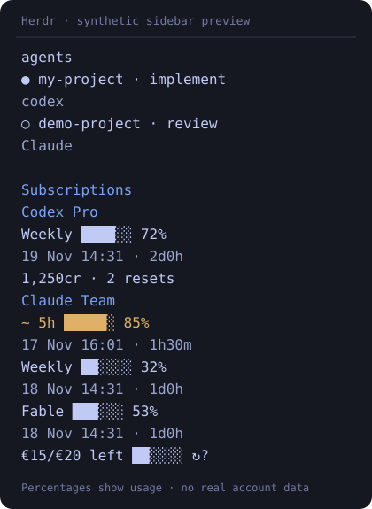

# Herdr Subscriptions

An independent **Subscriptions** section below Spaces and Agents in Herdr.
Click a heading to select a coding subscription, including a second login for the same provider. Each
quota shows usage and its next reset. Subscriptions end with plain, neutral
`Credits <amount>` and `Resets <count>` rows.

For sign-in commands, account configuration and daily use, see [Switch coding subscriptions in Herdr](docs/subscription-switching.md).



The independent section uses the companion Herdr 0.9.5 client included as a small
source patch. It has its own geometry and scrolling, stays visible when there
are no agents, and never attaches itself to an agent or workspace. The existing
Herdr server, protocol, agent processes and stock binary remain unchanged.

## Install the independent section

Requirements: macOS or Linux, Python 3.10+, Herdr 0.9.5, and signed-in `codex` and
`claude` CLIs. Python has no external dependencies. Building the companion client
also requires Rust/Cargo and **Zig 0.16.0**.

```sh
 git clone https://github.com/BenjaminObermeierTUM/herdr-subscriptions.git
 cd herdr-subscriptions
 herdr plugin link "$PWD" --enabled
 python3 scripts/build-client.py
```

The builder downloads the pinned upstream source, applies the included patch,
and puts the client in `native/bin/herdr`. It does not replace your installed
Herdr executable. Set `ZIG=/path/to/zig` if Zig is not on PATH.

Detach the old client with **Ctrl+B, then Q**, and run this at the outer shell:

```sh
./bin/herdr-with-subscriptions
```

The launcher backs up and validates the config, removes this plugin's agent-row
workaround, preserves the dashboard shortcut, starts the quota updater and
attaches the companion client. Detaching keeps the server and agents running.
Use this launcher whenever you want the independent section.

To start the companion with either `herdr` or `herder` from a fresh zsh
terminal, add this to `~/.zshrc`. Adjust the launcher path if you cloned the
repository outside `~/herdr-subscriptions`.

```zsh
herdr() {
  if (( $# == 0 )) && [[ ${HERDR_ENV:-} != 1 ]]; then
    "$HOME/herdr-subscriptions/bin/herdr-with-subscriptions"
  else
    command herdr "$@"
  fi
}
alias herder=herdr
```

Both spellings forward subcommands such as `herdr status` to the stock CLI.

The native section is client-only. It reads a private local JSON feed; there are
no new server messages, API methods, or wire-format fields. See
[the client patch notes](host-patches/README.md) for the exact base and validation.

## What it shows

- Codex quota windows, including additional model or feature windows when reported.
- Claude's five-hour, overall weekly and model-specific weekly limits.
- Next local reset times and countdowns; weekly limits sharing a reset are bracketed together.
- Codex's remaining usage-credit balance and saved-reset count.
- Claude's `Credits €X`. This represents remaining monthly extra-usage spending
  headroom; exact spending/cap and renewal details are in the dashboard.
- Claude saved-reset inventory from the signed-in Usage page when the Chrome monitor is enabled.

Higher quota percentages mean more **used**. A passed reset time is marked
pending until a fresh vendor report arrives. Missing credit-renewal dates are
described as unavailable in the dashboard; the plugin never invents a billing
date or treats missing data as zero. Claude's CLI does not currently return its
credit renewal date.

The sidebar shows one total `Resets` count for each subscription. The dashboard shows when Claude Usage was checked and which offers the page reported. An unavailable check or an overdue daily Claude reading shows `?`. Saved resets are separate from ordinary five-hour/weekly quota
refreshes and have no guaranteed weekly or monthly replenishment schedule.

## Dashboard and refresh

Press **Ctrl+B, then U** (`prefix+u`) for the full dashboard. It opens as a temporary
overlay and restores the underlying pane. Use `r` to refresh, arrows or `j`/`k` to
scroll and `q` to close. The plugin action menu also offers refresh and stop.

Vendor metadata refreshes every minute and just after the next reported
quota reset, with a 25-second deadline per provider. Placement/feed/countdowns
update every five seconds. If a poll fails, the sidebar and dashboard keep that
provider's last successful values for up to 30 minutes. After that, they show
`?` until a poll succeeds. A quota window that reaches its reset time shows
`?` immediately. Claude's saved-reset inventory uses its own daily check.

All standalone clients share one updater and feed, regardless of the shell or
Herdr session they were launched from. Startup drains older session writers and
replaces an updater running an older plugin version. Detaching clients leaves
the shared updater running until `stop` or uninstall. Stock fallback workers
remain session-local.

## Stock Herdr fallback

Stock Herdr has no standalone plugin-section slot. If you want to keep its
unmodified client, use the fallback that places rows below the final agent entry:

```sh
herdr plugin install BenjaminObermeierTUM/herdr-subscriptions
# From its plugin directory (shown by herdr plugin list --json):
python3 -m herdr_subscriptions setup --apply
```

This shares the agent list's scrolling and its 16-row limit. Excess rows are
explicitly flagged and remain available in the dashboard. Custom agent filters
or client-local unseen-completion ordering may differ from server ordering.

## Configuration

Find the directory with `herdr plugin config-dir subscriptions`. Optional `config.json`:

```json
{
  "subscriptions": [
    {"id": "codex-pro", "provider": "codex", "label": "Codex Pro"},
    {"id": "claude-team", "provider": "claude", "label": "Claude Team"},
    {"id": "claude-ultra", "provider": "claude", "label": "Claude Ultra", "config_dir": "~/.claude-secondary"}
  ],
  "refresh_seconds": 60,
  "reset_refresh_seconds": 86400,
  "stale_seconds": 1800,
  "sidebar_mode": "section"
}
```

Use a lower `stale_seconds` to shorten the 30-minute window.
The launcher sets `section` automatically. The fallback setup sets `agents`.
Each subscription has a stable ID and a display label. The provider selects the
CLI. Omit `config_dir` for its default login or set it to a distinct Claude
configuration directory or Codex home. Older `providers` configurations still
load. Quotas, last successful readings and reset actions follow the subscription.

Herdr detects Claude Ultra from the signed-in account and automatically omits
its five-hour meter and countdown. For Claude plans with a five-hour limit,
`show_idle_five_hour: false` hides the meter until the window starts.

### Select a subscription

Click a subscription heading in the local companion sidebar. The first click
opens a named tab in the current worktree. Later clicks return to that
subscription's tab in the same workspace and worktree. Each tab keeps its own
conversation. From the keyboard, press **Ctrl+B, U**, then **s**, and enter the
number beside the subscription. Both methods use the configured CLI login.

### Enable Claude reset monitoring

Sign in to Claude in Chrome with access to the workspace used by your CLI. From your permanent plugin checkout run:

```sh
python3 -m herdr_subscriptions browser-setup
```

Open `chrome://extensions`, turn on **Developer mode**, click **Load unpacked**
and select the directory printed for that subscription. For a second Claude login,
load its printed directory in a separate Chrome profile signed into that account.
Reload an existing monitor after upgrading. The reset-offer button sends its
request to that subscription's connected monitor. Chrome uses its signed-in session
to request the workspace Usage JSON. The helper opens no tab. Chrome must be
running for this check. The monitor checks once on first use, then once every
24 hours by default. Set `reset_refresh_seconds` to any value from 60 to 86400
and reload the monitor to change that interval. When a Claude quota first reaches 100%, the Herdr updater wakes the
monitor immediately. It sends one request while that window stays exhausted.
A crossing observed while Chrome is closed is picked up when it restarts.

Quota percentages are sampled every 60 seconds by default, or every 30–60
seconds if configured. Previously configured longer intervals are capped at
60 seconds. The monthly spending cap does not trigger a reset lookup. Codex
returns its balance with those ordinary quota samples. Detailed Codex reset
metadata is requested once a day or on a newly exhausted quota.

The local Chrome messaging host sleeps on a private event pipe between checks.
It queries the CLI for the active workspace only when an inventory check is due.
Missing or unrecognized provider data displays `?`. Historical manual entries
remain dated in the dashboard. The signed-in web endpoint is undocumented;
provider rate limits and loss of sign-in can delay a check.

### Use a saved reset

- **Codex** shows your saved-reset count in the sidebar. When a covered limit
  reaches 100%, open the dashboard with **Ctrl+B, then U** and press `c`.
  You can also run `python3 -m herdr_subscriptions reset-codex` from the plugin
  checkout. Review the limit, then type `y` and press Enter to use one reset.
  Press Enter at the prompt to cancel.
- **Claude:** Click **Open Claude reset offers**, choose **Reset for free** on
  the matching offer, and confirm in Claude. The action requires both the
  browser and CLI to show an exhausted covered limit and the Usage page to
  show an enabled offer. The monthly spending cap is excluded.
- **Stock Herdr:** Open the dashboard with **Ctrl+B, then U**. Eligible actions
  also appear there (`c` for Codex, `a` for Claude).

After upgrading, rebuild the companion client, detach the old client and relaunch
`bin/herdr-with-subscriptions` to enable mouse actions. Old clients can display
updated text but do not handle clicks.

## Useful commands

Run from the plugin checkout:

```sh
python3 -m herdr_subscriptions status
python3 -m herdr_subscriptions status --json
python3 -m herdr_subscriptions refresh
python3 -m herdr_subscriptions diagnostics
python3 -m herdr_subscriptions status --demo --sidebar
python3 -m herdr_subscriptions stop
python3 -m herdr_subscriptions unsetup --apply
```

To uninstall, detach the companion client, run `unsetup --apply`, uninstall the
plugin with `herdr plugin uninstall subscriptions`, and reattach with stock Herdr.
Setup/unsetup edits only its marked block and keeps a private backup first.

## Data access

The background worker queries the signed-in CLIs for usage metadata. Codex uses
`account/rateLimits/read`. Claude uses `get_usage` with `skip_behaviors` in
safe mode, with tools, hooks, MCP servers and session persistence disabled.

The optional Chrome monitor requests the workspace Usage JSON on claude.ai.
Chrome handles sign-in. The monitor passes counts, offer types, expirations
and exhausted window names to a local native
messaging host. Account data stays in the private plugin state directory.
To remove the monitor, remove it at `chrome://extensions` and delete `dev.herdr.subscriptions.json` from Chrome's user
`NativeMessagingHosts` directory.

An interactive, confirmed Codex reset uses `account/rateLimitResetCredit/consume`.
A private idempotency key identifies retries for the same account and window.
Polling never initiates a redemption. Claude handles its own confirmation.
Official guidance: [Claude limit resets](https://support.claude.com/en/articles/17007452-what-is-a-limit-reset)
and [Codex banked resets](https://help.openai.com/en/articles/20001498-how-resets-work-in-codex).

## Development

```sh
python3 -m unittest discover -s tests -v
python3 -m compileall -q herdr_subscriptions scripts
node --test tests/browser-usage.test.js
```

Tests use synthetic metadata and fake provider clients. The companion patch was
also validated against Herdr's client UI suite. The repository preview contains
synthetic data only.

Independent community plugin. Plugin code is MIT licensed. The companion patch
modifies Apache-2.0-licensed Herdr; its upstream license is included. Herdr,
Codex and Claude belong to their respective owners.
